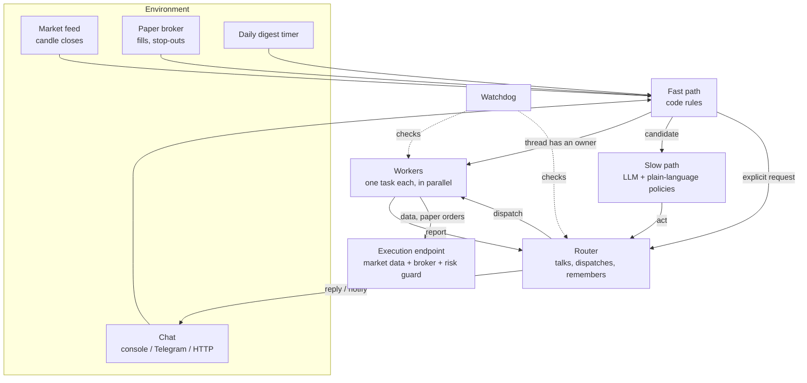

# Super-Agent Trading Bot

An always-on, event-driven LLM trading agent in TypeScript. It watches crypto
markets on any candle timeframe from 1 minute to 1 week. When an opportunity
appears, it either **sends you a signal** or **trades it on a paper account by
itself**. You can talk to it over chat while it works.

It is built on the **Super-agent architecture**:
- one long-lived Router that talks to people;
- isolated Workers that do the work in parallel;
- event triggers instead of prompts;
- asynchronous tools;
- an execution endpoint that holds the broker;
- an independent Watchdog.

The design follows
[*Exploring Super-agent Design: Towards a More Autonomous Agent System*](https://x.com/DeepSeekHarness/status/2116857257245987236)
and maps every module of that article to code. The full implementation contract
is in [docs/SYSTEM-DESIGN.md](docs/SYSTEM-DESIGN.md).

> Paper trading only. There is no live order path in this codebase. Nothing here is financial advice.



## Two modes

| | `BOT_MODE=signals` | `BOT_MODE=autonomous` |
|---|---|---|
| On a good setup | A worker checks it and records a signal with entry, stop, target, confidence and reasoning. You get a notification. | A worker checks it and opens a paper position with a stop and target, then manages it until it closes. You get notified on entry and exit. |
| Order tools | Not registered at all | `place_paper_order`, `update_brackets`, `close_position` |
| Evaluated on | Every candle close of each timeframe in `TIMEFRAMES` | Same |
| Results | Signal scorecard: win rate, average R, expired | Paper P&L, R multiples, the same scorecard |

The timeframe is a setting: `TIMEFRAMES=1m` gives a 1-minute digest of
opportunities, and `TIMEFRAMES=30m,1h,1d` watches all three at once.

## Features

**Market and strategy**
- Live Binance market data with no API key, for any symbols you list.
- Every timeframe Binance offers: `1m 3m 5m 15m 30m 1h 2h 4h 6h 8h 12h 1d 3d 1w`. Each one is polled right after its candle closes.
- Indicators: EMA 20/50/200, RSI, ATR, Bollinger Bands, Donchian channel, volume z-score. None of them look ahead, and a test checks that.
- Four setup detectors: `trend_pullback`, `breakout`, `rsi_reversal`, `squeeze_release`. Each runs long and short, with a score, an ATR-based stop, and a target at `TARGET_R`.
- Near-setup detection. It feeds speculative pre-analysis, described below.
- A walk-forward backtester for any detector. Workers run it as a background job.

**Agent architecture**
- **Router + Workers.** One long-lived Router handles every conversation and dispatch, and has no market or order tools. Workers each own one task in their own context. `MAX_WORKERS` caps how many think at once, and a worker waiting for events holds no slot.
- **Batching.** Events that arrive while the Router is thinking are merged into its next call.
- **Two-stage filter.** Code drops noise first: no setup, low score, duplicates, unknown chats. Then one batched LLM call judges what's left against **policies you write in plain language**. Tell the bot "ignore SOL 1m until tomorrow" and it adds an expiring policy.
- **Threads and pass-through.** A worker subscribes to the threads it owns, such as `mkt:BTCUSDT:1h` or `pos:pos_...`. Follow-up events go straight to it with no Router call, and the Router still sees them as `FYI` lines.
- **Inline & Spill + Chain of Recall.** Every object has an id: trigger, worker, signal, position, job, policy, message. Long content is cut off behind a `recall(id, offset)` pointer. Each recall lists the linked ids, so the agent can walk from a chat message to a worker, its signal, and the position months later.
- **Acting ahead.** A near-setup starts a silent pre-analysis worker. If the setup confirms at the close, the finished analysis rides along with the event. If it doesn't, the work is discarded and nobody hears about it.
- **Full duplex.** Backtests run as jobs: `start_backtest` returns at once and the result arrives later as an event. New messages reach a session after its current tool step, not after its whole task.
- **Append-only sessions.** History is never edited. A long session writes a summary and continues in a new epoch. Prompt caches stay warm, and providers that bind reasoning to the exact history keep working.

**Trading safety (code, not prompts)**
- A paper broker with its own ledger. It models fees and slippage. Stop and target brackets are checked on 1-minute candles: the stop wins when one candle touches both, a gap through the stop fills at the open, and the entry minute is ignored.
- A risk guard inside the execution endpoint checks every order:
  - a stop is mandatory;
  - risk per trade and position size have caps;
  - open positions are limited;
  - a daily loss limit applies;
  - a symbol has a cooldown after a stop-out;
  - only listed symbols trade;
  - shorts are off unless you enable them.
- An explicit size that breaks a rule is **rejected with the maximum allowed**, never silently shrunk.
- A kill switch. You can flip it from chat, and the Watchdog flips it **in code** when the daily loss limit is hit.

**Always on**
- Crash-safe state in SQLite. After a restart, workers resume with their history and subscriptions, queued filter work is re-run, interrupted jobs are reported to their owners, and broker events from the downtime are delivered.
- The execution endpoint runs in-process or as a **separate daemon** (`npm run endpoint`) on the machine that should hold the ledger, over token-authenticated JSON-RPC. If it goes offline, workers are told and woken when it returns.
- A Watchdog session checks every `WATCHDOG_INTERVAL_SEC`:
  - market feed staleness;
  - endpoint health;
  - LLM failures and refusals;
  - stalled or idle-forever workers;
  - long jobs;
  - the daily loss limit.

  When something is wrong it can correct or stop a worker, adjust policies, and alert you. Ask it things directly with `/watchdog ...`.
- A daily digest at `DAILY_DIGEST_TIME` (UTC) covers signals, the scorecard, paper results, and notable events. It catches up after a restart and is never sent twice for the same day.

**Channels**
- Console chat, a two-way Telegram bot (chat allowlist; group messages only when addressed to the bot, or judged by the filter), a Discord webhook, a generic JSON webhook, and an HTTP API.
- Channel norms are enforced in code. On IM channels, messages are capped at `IM_WORD_LIMIT` words, and an over-long reply bounces back to the model to shorten.
- Status API: `GET /status`, `GET /objects/:id` (recall any object), `POST /message`, `GET /outbox`.

**Any LLM provider, per role**
- Router, Worker, Filter and Watchdog each take their own `*_PROVIDER`, `*_MODEL` and `*_EFFORT` from `.env`.
- Supported: `anthropic` (official SDK, with prompt caching and server-side refusal fallback), plus `openai`, `deepseek`, `groq`, `openrouter`, `xai`, `gemini`, `mistral`, `together`, and `ollama` (all through the official OpenAI SDK), and any `openai-compatible` endpoint.
- `mock` is a deterministic scripted model, for running the whole system offline with no key.

## Quick start

Requires Node.js 22.13 or later.

```bash
git clone https://github.com/IslamBaraka90/Super-Agent-Trading-Bot.git
cd Super-Agent-Trading-Bot
npm install
cp .env.example .env
```

Try it with no API key. The mock model drives the whole system against live market data:

```bash
LLM_PROVIDER=mock npm run dev
```

With a real model, set the provider in `.env`:

```bash
LLM_PROVIDER=anthropic
LLM_MODEL=claude-opus-5-5
ANTHROPIC_API_KEY=...
```

or any OpenAI-compatible provider:

```bash
LLM_PROVIDER=deepseek
LLM_MODEL=deepseek-chat
DEEPSEEK_API_KEY=...
```

Production build:

```bash
npm run build
npm start
```

## Talking to the bot

Type in the console, message the Telegram bot, or use the HTTP API:

```bash
curl -s localhost:8787/message -H 'content-type: application/json' -d '{"text":"What are you watching?"}'
curl -s localhost:8787/outbox
curl -s localhost:8787/status
curl -s localhost:8787/objects/mkt:BTCUSDT:1h
```

Things you can say:
- "Analyse ETH on the 4h and tell me if there's a trade."
- "Ignore SOL 1m setups until tomorrow." This adds an expiring filter policy.
- "Stop trading." This turns on the kill switch first, then confirms.
- `/watchdog why did the BTC worker stop?`

## Running the execution endpoint on another machine

```bash
# on the machine that should hold the paper ledger
ENDPOINT_TOKEN=change-me npm run endpoint
```

```bash
# on the agent machine, in .env
EXECUTION_ENDPOINT=http://<that-host>:8788
ENDPOINT_TOKEN=change-me
```

## Project layout

| Path | Article module | What it does |
|---|---|---|
| `src/router/` | Two-level architecture: Router | Long-lived session, batching, dispatch, replies |
| `src/workers/` | Two-level architecture: Workers | Isolated task sessions, tools per mode, concurrency cap |
| `src/filter/` | Event filtering | Code fast path, LLM slow path, plain-language policies |
| `src/threads/` | Event routing | Threads, many-to-many subscriptions, pass-through |
| `src/context/` | Context organization | Inline & Spill rendering, Chain of Recall |
| `src/speculative/` | Acting ahead | Pre-analysis of near-setups |
| `src/agent/` | Full duplex | Append-only sessions, async jobs, tool registry |
| `src/channels/` | Multi-channel | Console, Telegram, Discord, webhook, HTTP, style rules |
| `src/state/` | Compute / state separation | SQLite store for everything the agent knows |
| `src/endpoint/` | Compute / environment separation | Market data, paper broker and risk guard, local or remote |
| `src/watchdog/` | Watchdog | Control loop outside the main system |
| `src/llm/` | - | Provider-neutral interface, Anthropic, OpenAI-compatible, and mock adapters |
| `src/market/`, `src/trading/`, `src/signals/`, `src/digest/` | - | Indicators, detectors, backtest, broker, risk, signal scorecard, digest |

## Tests

```bash
npm test
npm run typecheck
```

The suite has 61 tests and needs no network or API key. It covers:
- indicators, including the no-look-ahead check;
- detectors and the backtester;
- every risk rule;
- broker accounting and bracket fills;
- that every LLM request extends the previous one, so history is never rewritten;
- batching, mid-turn delivery, compaction, retry and resume;
- fast-path routing;
- Inline & Spill and Chain of Recall;
- end-to-end runs of both modes, including a process restart in the middle of an open trade, the daily digest, the watchdog's kill switch, and chat.

## Project status

Version 0.1. The architecture is complete and tested end to end with the mock
model, with live Binance market data, and with real OpenAI models (GPT-6.1
Terra, GPT-6.1 Sol and GPT-6 Luna). Other providers have not been run against
their live APIs yet. The prompts are first versions: expect to tune them for
the model you choose, and watch the first days of signals before you trust the
scorecard.

## License

MIT
