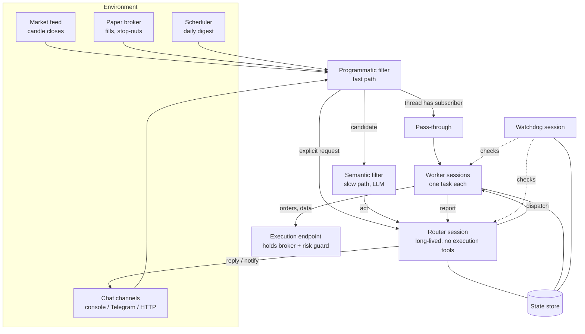
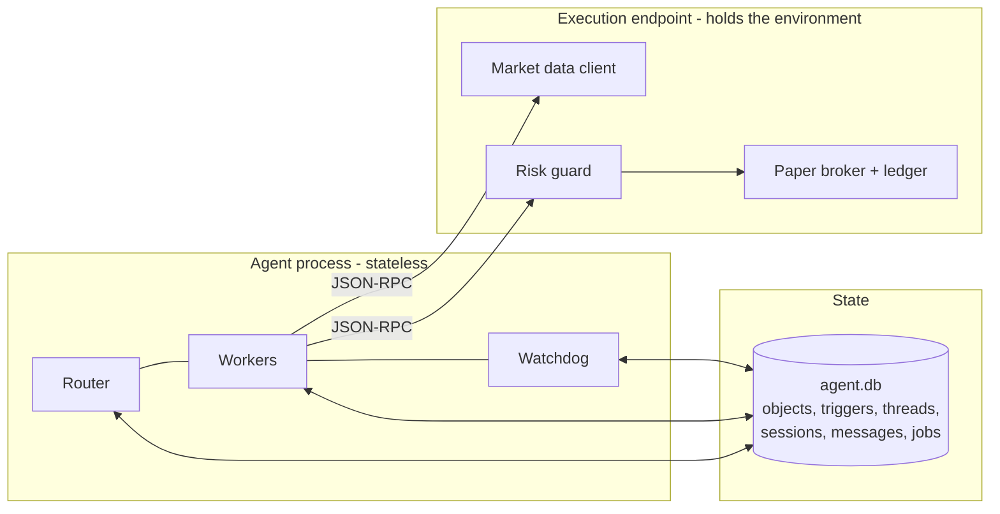

# System design

This document is the implementation contract for the Super-Agent Trading Bot.
Every module in `src/` maps to one section here, and every section maps to one
module of the Super-agent architecture described in
[*Exploring Super-agent Design: Towards a More Autonomous Agent System*](https://x.com/DeepSeekHarness/status/2116857257245987236).

The bot is **one continuous trading agent**. It watches markets and chat
channels at the same time, works on several symbols in parallel, acts without
being asked when a setup appears, and stays online across restarts. It runs in
one of two modes:

| Mode | What it does with an opportunity | Can it trade? |
|---|---|---|
| `signals` | Sends a notification with entry, stop, target, confidence and reasoning | No - order tools are not even registered |
| `autonomous` | Opens, manages and closes positions on its own | Paper accounts only - no live broker adapter exists in the codebase |

---

## 1. The four properties and where they come from

| Property | Meaning for a trading bot | Provided by |
|---|---|---|
| Continuous | Ask on Telegram "why did you skip ETH?", then on the HTTP API "close it" - same agent, same memory | Router session + Chain of Recall (§2, §3.3) |
| Productive | BTC 1h breakout, ETH 30m reversal and the daily digest are analysed at the same time | Worker pool (§2.2) + async jobs (§4.1) |
| Proactive | Nobody types a prompt; candle closes, fills and stop-outs drive the agent | Event-driven triggers (§3) + speculative pre-analysis (§3.4) |
| Persistent | Restart the process and every worker, subscription and queued event resumes | State store + execution endpoint + watchdog (§5, §6) |

---

## 2. Two-level architecture



### 2.1 Router (`src/router/`)

- One long-lived LLM session. It is the **only** component that talks to people.
- Tools: `dispatch_worker`, `message_worker`, `stop_worker`, `list_workers`,
  `reply`, `notify`, `recall`, `set_policy`, `remove_policy`, `ignore`.
  It has **no** market, order or shell tools, so it can never become the
  bottleneck by doing the work itself.
- **Batching.** Triggers that arrive while the Router is thinking wait in a
  queue. When the current turn ends, the whole queue is rendered into one user
  message and sent in one call. Long input, short output: the prefill reads the
  batch in parallel, so the per-decision cost falls as load rises.
- **Append-only history.** The system prompt and the tool list are frozen at
  session start, and new information is only ever appended. When the history
  passes `ROUTER_COMPACT_TOKENS`, the Router writes a summary and starts a new
  epoch with that summary as its first message; nothing is snipped from the
  middle. (Some providers bind reasoning blocks to the exact prefix that
  produced them, so editing history mid-conversation is rejected.)
- Uses a lighter model if you like (`ROUTER_MODEL`): its work is routing, not
  analysis.

### 2.2 Workers (`src/workers/`)

- One session per task, with its own context, and the full tool set for that task:
  market data, indicators, backtests, signals, and (autonomous mode only) paper orders.
- Never talk to people. They `report` to the Router, which decides what to say.
- Subscribe to the threads they own (`mkt:BTCUSDT:1h`, `pos:pos_12`), so
  follow-up events reach them directly without a Router call.
- Lifecycle: `queued -> running -> idle (waiting for events) -> running -> ... -> done | stopped | failed`.
  `MAX_WORKERS` caps concurrency; extra dispatches queue.
- A worker managing an open position stays alive until the position closes.

---

## 3. Event-driven triggers

Everything the agent reacts to is a `Trigger`:

```ts
interface Trigger {
  id: string;          // trg_...
  source: "market" | "chat" | "broker" | "schedule" | "worker" | "job" | "system";
  kind: string;        // candle_closed, setup, message, fill, stop_hit, daily_digest, report, job_done, ...
  threadKey: string;   // the event stream it belongs to
  at: number;          // epoch ms
  summary: string;     // one line, always inlined
  payload: object;     // full data, spilled when large
  explicit?: boolean;  // addressed to the bot directly
  replyTo?: { channel: string; target?: string };
}
```

Thread keys:

| Key | Stream |
|---|---|
| `mkt:<SYMBOL>:<TF>` | Candle closes for one symbol and timeframe |
| `pos:<positionId>` | Fills, stop/target hits, closes for one paper position |
| `chat:<channel>:<conversation>` | One chat conversation |
| `job:<jobId>` | One background job |
| `sys:endpoint` | Execution endpoint online / offline |
| `digest:<YYYY-MM-DD>` | The daily digest |

### 3.1 Filtering (`src/filter/`)

**Fast path - code** (`programmatic.ts`):

1. Source policy per channel: `explicit` (only direct messages and commands),
   `candidate`, or `ignore`. Author allowlists for chat.
2. Duplicate suppression (same trigger id or same candle twice).
3. Market triggers run the setup detectors (§7). No setup and no subscriber -> dropped.
   Setup score below `MIN_SETUP_SCORE` -> dropped.
4. A thread with a subscriber -> passed straight through to its workers (§3.2).

**Slow path - LLM** (`semantic.ts`): surviving candidates are judged in one
batched call against **policies written in plain language** and stored in the
database (`pol_...`). The owner can add or remove policies at any time by
telling the Router ("ignore 1m setups on SOL until tomorrow").

### 3.2 Routing (`src/threads/`)

- Subscriptions are many-to-many: a worker can own several threads, and a thread
  can have several workers.
- **Subscribed (fast path):** code delivers the event to every subscriber.
  The Router does not spend a call on it, but the event is appended to the
  Router's next batch as a compact `FYI` line so its global picture stays complete.
- **Unsubscribed (slow path):** the Router decides - dispatch, reply, or ignore.
- A worker can `unsubscribe` or `handback` an event it does not own.

### 3.3 Context: Inline & Spill and Chain of Recall (`src/context/`)

- Every object has an ID and lives in the `objects` table: triggers, threads,
  workers, signals, orders, positions, jobs, policies, digests.
- **Inline:** an object is rendered as its ID, a one-line summary and the
  IDs + summaries of its closest links (thread, worker, signal, position).
- **Spill:** content above the budget is cut and replaced by a pointer:
  `... (+1,240 chars, recall("cnd_9", offset=800))`.
- **Chain of Recall:** `recall(id)` returns the same rendering one hop further,
  so the Router can walk `trigger -> thread -> worker -> signal -> position`
  months later without keeping any of it in its window.

### 3.4 Acting ahead (`src/speculative/`)

When a detector reports a **near-setup** (price within `NEAR_SETUP_ATR` of a
breakout level, RSI approaching an extreme), a silent speculative worker
prepares the analysis in the background. If the setup confirms on the next
close, the finished analysis is inlined into the trigger the Router receives, so
the notification goes out a full analysis-cycle earlier. If it does not confirm,
the work is discarded and nobody hears about it.

---

## 4. Full-duplex, multi-channel interaction

### 4.1 Asynchronous tools (`src/agent/jobs.ts`)

Long operations (backtests, multi-symbol scans) are jobs. `start_backtest`
returns `Started job_12` immediately; the result arrives later as a `job_done`
trigger on the owning session. `stop_job` cancels one. A session is never
blocked by its own tools, so a worker can answer a Router message while its
backtest runs.

### 4.2 Channels (`src/channels/`)

| Channel | Direction | Style norm (enforced in code) |
|---|---|---|
| console | in + out | IM: at most 100 words, conclusion first |
| telegram | in + out | IM: at most 100 words, conclusion first |
| discord | out (webhook) | IM: at most 100 words |
| webhook | out | Async: structured, full detail |
| http | in (`POST /message`) + out (response log) | IM |

The `reply` / `notify` tools reject an over-long IM message with an error that
tells the model to shorten it, so the cap is a rule, not a suggestion.

---

## 5. Separating compute, state and environments



### 5.1 Compute from state

The agent process keeps nothing important in memory. Sessions (every message,
append-only), triggers, subscriptions, workers, jobs and objects are written to
`agent.db` as they happen. On restart the process reloads the Router epoch,
resumes every non-finished worker with its history and subscriptions, re-queues
undelivered triggers, and marks interrupted jobs so their owners can restart them.

### 5.2 Compute from environment

The **execution endpoint** is the only place that talks to the broker and the
market-data API. It runs in-process (`EXECUTION_ENDPOINT=local`) or as a
separate daemon (`npm run endpoint`, `EXECUTION_ENDPOINT=http://host:8788`)
on the machine that holds the broker account. It owns:

- the market-data client,
- the paper broker and its ledger (`paper.db`) - the broker is the source of truth for positions,
- the **risk guard**, which validates every order in code.

If the endpoint goes offline, tools fail fast with an `endpoint offline` result,
workers subscribe to `sys:endpoint`, and they are woken with an `online` trigger
when it reconnects.

---

## 6. Watchdog (`src/watchdog/`)

An independent session driven by a timer (`WATCHDOG_INTERVAL_SEC`).

**Deterministic checks** (code, every tick): market feed staleness, LLM error
rate, endpoint health, workers with no progress for `WORKER_STALL_MIN`, jobs
over their time limit, daily loss against `MAX_DAILY_LOSS_PCT`.

**Judgement** (LLM, only when a check flags something or on every Nth tick):
is each running worker making progress toward its task or looping? It can
`message_worker`, `stop_worker`, set the `kill_switch`, add or remove filter
policies, and `notify_owner`.

The owner can talk to it directly: a chat message starting with `/watchdog`
goes to the watchdog session instead of the Router ("/watchdog why did the ETH
worker stop?").

---

## 7. Trading domain

### 7.1 Market data (`src/market/`)

- Binance public market-data REST (`MARKET_DATA_URL`, default
  `https://data-api.binance.vision`), no API key.
- The feed polls each `(symbol, timeframe)` just after its candle closes and
  emits `candle_closed` with the closed candle and an indicator snapshot.
- Supported timeframes: `1m 3m 5m 15m 30m 1h 2h 4h 6h 8h 12h 1d 3d 1w`.

### 7.2 Indicators and setup detectors

Indicators: EMA, SMA, RSI (Wilder), ATR (Wilder), Bollinger Bands, Donchian
channel, volume z-score.

| Detector | Long when | Short when |
|---|---|---|
| `trend_pullback` | EMA20 > EMA50, price tags EMA20 and closes back above it | mirror |
| `breakout` | Close above the 20-bar Donchian high with volume z > 1.5 | mirror |
| `rsi_reversal` | RSI crosses back above 30 while price is above EMA200 | mirror |
| `squeeze_release` | Bollinger width in its lowest 10% of 100 bars, then a close outside the band | mirror |

Every setup carries entry, an ATR-based stop, a target at `TARGET_R` x risk,
and a score in [0, 1]. Each detector also emits **near** states that feed §3.4.

### 7.3 Signals and the scorecard

A signal (`sig_...`) is stored with entry, stop, target, timeframe and expiry.
The signal tracker checks every open signal against new candles and resolves it
as `target_hit`, `stop_hit` or `expired`. The daily digest reports the
scorecard: signals sent, win rate, average R.

### 7.4 Paper broker (`src/trading/paper-broker.ts`)

- Account in quote currency (`PAPER_STARTING_CASH`, default 10,000 USDT).
- Market orders fill at the latest price with `PAPER_SLIPPAGE_BPS` slippage and
  `PAPER_FEE_BPS` fees.
- Every position has a stop and may have a target. Brackets are checked on each
  1-minute candle; when a candle touches both, the stop is assumed first
  (conservative); a gap through the stop fills at the open.
- Shorts are simulated only when `ALLOW_SHORTS=true`.

### 7.5 Risk guard (`src/trading/risk.ts`) - code, not prompts

Checked inside the execution endpoint for every order, so no prompt and no
compromised agent session can skip it:

| Rule | Env var |
|---|---|
| Kill switch blocks all new entries | set by watchdog / owner |
| A stop is required on every entry | - |
| Risk per trade <= % of equity | `RISK_PER_TRADE_PCT` |
| Position notional <= % of equity | `MAX_POSITION_PCT` |
| Open positions <= N | `MAX_OPEN_POSITIONS` |
| Daily loss limit blocks new entries | `MAX_DAILY_LOSS_PCT` |
| Cooldown after a stop-out on the same symbol | `STOPOUT_COOLDOWN_MIN` |
| Symbol must be in `SYMBOLS` | `SYMBOLS` |

If the model asks for more size than the rules allow, the guard does not shrink
it silently: it rejects the order and says what the maximum is.

---

## 8. Replaceable LLM providers (`src/llm/`)

One interface, `LlmClient.complete(request) -> response`, with tool calls in a
provider-neutral shape. Each role (`router`, `worker`, `filter`, `watchdog`)
picks its own provider and model from the environment and falls back to
`LLM_PROVIDER` / `LLM_MODEL`.

| `*_PROVIDER` | SDK | Notes |
|---|---|---|
| `anthropic` | `@anthropic-ai/sdk` | Prompt caching on, server-side refusal fallback on (`ANTHROPIC_FALLBACKS`), reasoning blocks replayed unchanged |
| `openai` | `openai` | api.openai.com |
| `deepseek`, `groq`, `openrouter`, `xai`, `gemini`, `mistral`, `together`, `ollama` | `openai` | OpenAI-compatible presets with their base URL and key variable |
| `openai-compatible` | `openai` | Any other endpoint via `LLM_BASE_URL` |
| `mock` | none | Deterministic scripted model for tests and offline demos |

The adapter stores each assistant turn's raw provider payload next to the
neutral form and replays it verbatim to the same provider, so reasoning blocks
and provider-specific fields survive the round trip.

---

## 9. Data model (`src/state/store.ts`)

| Table | Holds |
|---|---|
| `objects` | Every addressable object: id, kind, summary, body (JSON), links (JSON ids), created/updated |
| `triggers` | Every trigger and its routing outcome (dropped / filtered / passed / queued / handled) |
| `subscriptions` | thread key <-> session id |
| `sessions` | id, role, status, epoch, task, model |
| `messages` | session id, epoch, seq, neutral message JSON, raw provider payload - append-only |
| `jobs` | id, owner session, kind, status, params, result |
| `kv` | kill switch, feed cursors, counters |

`paper.db` (owned by the execution endpoint): `account`, `positions`,
`orders`, `fills`, `equity_marks`.

---

## 10. Security

- **Paper only.** There is no live order path in the code. The endpoint refuses
  to start with any broker other than the internal paper broker.
- **Credentials never reach a model.** Broker and channel tokens live in the
  endpoint and channel adapters; no tool returns them and no prompt contains them.
- **Untrusted input is data.** Chat text and market payloads are rendered inside
  clearly delimited trigger blocks, the system prompts tell every session to
  treat them as data, and every state-changing tool is guarded in code
  (risk guard, author allowlists, kill switch).
- **The risk guard lives with the broker,** not with the agent, so a hijacked
  session can at most place orders that the rules already allow on a paper account.

---

## 11. Failure handling

| Failure | Behaviour |
|---|---|
| LLM API error | Retried by the SDK; then the session is marked `error` and the watchdog sees it |
| Refusal / empty response | Recorded on the session; worker reports failure to the Router |
| Market API down | Feed marks itself stale; watchdog notifies the owner |
| Endpoint offline | Tools return `endpoint offline`; workers wait on `sys:endpoint` |
| Process crash | Restart resumes from `agent.db` (§5.1) |
| Worker loops | Watchdog nudges, then stops it; Router is told why |
| Daily loss hit | Risk guard blocks entries; watchdog trips the kill switch and notifies |

---

## 12. What is deliberately left out

- Live trading of any kind.
- Order types beyond market entries with stop/target brackets.
- Router sharding and worker-to-worker messaging (the article's open problems;
  one Router is enough at this scale - see §2.1 batching).
- Long-term memory beyond Chain of Recall over the object store.
